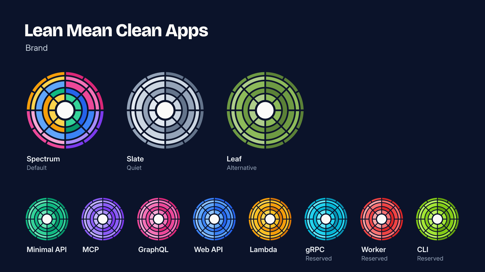

<p align="center">
  
</p>

# Lean Mean Clean Apps brand

Logos, social templates and colour tokens for the Lean Mean Clean Apps .NET templates. Every file is generated from a handful of scripts, so the whole family stays in step. Nobody has opened Illustrator in anger, and nobody ever will.

**Docs:** [leanmeancleanapps.github.io/brand](https://leanmeancleanapps.github.io/brand/), with every file, the full brand rules and a guide to where each asset goes.

## Where each file goes

| Where | File |
| --- | --- |
| GitHub organisation avatar | [org-spectrum-square-512.png](assets/logos/org-spectrum/png/org-spectrum-square-512.png) |
| NuGet.org and Docker Hub avatar | The same file. NuGet.org takes its avatar from [Gravatar](https://gravatar.com), and some Docker accounts do too. |
| Organisation profile README banner | [banner.png](assets/social/png/banner.png) |
| Repository social preview (Settings → General → Social preview) | [assets/social/png/](assets/social/png/), one per repository |
| NuGet package icon | Replace `icon.png` at the root of each template repository with `assets/logos/<template>/png/<template>-square-128.png`. The csproj already packs it as `images/icon.png`. |
| Website favicons and manifest icons | `assets/logos/<mark>/web/` |
| Link preview for a website | [og-image.png](assets/social/png/og-image.png) |

## The marks

| Mark | Folder | Hue | Used for |
| --- | --- | --- | --- |
| Organisation, spectrum | `org-spectrum` | Every template hue | The default: avatars, favicons, banners and link previews |
| Organisation, slate | `org-slate` | Slate | The quiet version, for when spectrum would be too loud |
| Organisation, leaf | `org-leaf` | Leaf | The alternative, and the accent colour for organisation websites |
| [Clean Minimal API](https://leanmeancleanapps.github.io/minimalapi/) | `minimalapi` | Emerald | [CleanMinimalApi](https://github.com/stphnwlsh/CleanMinimalApi) |
| [Clean Model Context Protocol](https://leanmeancleanapps.github.io/mcp/) | `mcp` | Violet | [CleanModelContextProtocol](https://github.com/stphnwlsh/CleanModelContextProtocol) |
| [Clean GraphQL API](https://leanmeancleanapps.github.io/graphql/) | `graphql` | Pink | [CleanGraphQLApi](https://github.com/stphnwlsh/CleanGraphQLApi) |
| [Clean Web API](https://leanmeancleanapps.github.io/webapi/) | `webapi` | Blue | [CleanWebApi](https://github.com/stphnwlsh/CleanWebApi) |
| [Clean Lambda Function](https://leanmeancleanapps.github.io/lambda/) | `lambda` | Amber | [CleanLamdaFunction](https://github.com/stphnwlsh/CleanLamdaFunction) |
| gRPC, Worker, CLI | `grpc`, `worker`, `cli` | Cyan, red, lime | Reserved for templates that don't exist yet. Ambitious, we know. |

## What's in here

```text
assets/
  logos/<mark>/svg/     SVG logos in every variant
  logos/<mark>/png/     PNG logos from 16 to 1024 pixels
  logos/<mark>/web/     favicon.svg, favicon.ico, apple-touch-icon.png, manifest icons
  logos/mono/           Single-colour ink and paper versions
  social/png/           Social previews, banner and link preview, ready to upload
  social/svg/           The same, with text as outlines
  social/source/        The same, with live text and named layers for editing
tokens/                 tokens.json, tokens.css and Starlight themes
scripts/                The generator
fonts/                  Bricolage Grotesque, Inter and JetBrains Mono
```

Logo files are named `<mark>[-small][-variant][-size]`:

| Variant | Background | Best for |
| --- | --- | --- |
| *(none)* | Transparent, for dark backgrounds | Headers in dark mode, slides, video |
| `-light` | Transparent, for light backgrounds | Headers in light mode, print on white |
| `-tile` | Ink rounded square | App icons, favicons, cards |
| `-square` | Ink square, edge to edge | Avatars on platforms that crop or round the corners themselves |
| `-circle` | Ink circle | Stickers, round badges |
| `-layered` | Ink rounded square, one named layer per ring | Editing in Inkscape, Figma or Illustrator |
| `-small` | Any of the above | 48 pixels and below |

The editable social SVGs in `social/source/` need the three typefaces in `fonts/` installed, or your editor will swap in something else.

## Using the mark

- **One hue per mark.** A template uses only its own hue. The organisation uses spectrum, slate or leaf.
- **Rings alternate shades, and the left half is one shade lighter.** Every change of colour lands on a gap, never in the middle of a segment.
- **Use the small version at 48 pixels and below.** It keeps the core and two rings with wider cuts so it still reads at favicon size.
- **Dark backgrounds by default.** On light backgrounds use the `-light` version, or keep the ink tile or circle behind the standard one.
- **Leave clear space** of an eighth of the mark's width on every side. The tile, square and circle versions already include it.
- **Please don't** add glows, gradients or shadows, rotate it, mix two templates' hues, put text inside it, or redraw it by hand. Fix the generator instead. The mark has been through enough.

## Colours and type

The neutrals are ink `#0B132A` and paper `#FBFAF8`. Template hues use the [Tailwind CSS](https://tailwindcss.com/docs/colors) scales, and leaf is our own green. Every step of every scale is in [tokens/tokens.css](tokens/tokens.css) as `--lmca-<scale>-<step>` and in [tokens/tokens.json](tokens/tokens.json) in the Design Tokens Community Group format. `tokens/starlight/` has a base theme and one accent per template for Starlight docs sites.

Headings use [Bricolage Grotesque](https://fonts.google.com/specimen/Bricolage+Grotesque), body text uses [Inter](https://rsms.me/inter/), and code uses [JetBrains Mono](https://www.jetbrains.com/lp/mono/).

## Building

Everything in `assets/` and `tokens/` is generated from `scripts/brand.mjs`, which holds the organisation, the templates and the colour scales. You need Node 24.

```sh
npm ci
npm run build
```

Commit what changes. CI runs the same build and fails if the committed files are out of date, so "I'll regenerate it later" isn't an option.

To add a template, add it to `templates` in `scripts/brand.mjs` with a hue nobody else uses, then build. You get its logos, web icons, social preview and Starlight accent. The ring shapes live in `scripts/geometry.mjs`.

## Contributing and support

Changes are welcome: see [CONTRIBUTING.md](CONTRIBUTING.md). For help, bugs and ideas, open an issue. Security problems go through the [security policy](https://github.com/LeanMeanCleanApps/.github/blob/main/SECURITY.md), not an issue.

Everything here is built and maintained by the Lean Mean Clean Apps team, which is [Stephen Walsh](https://github.com/stphnwlsh) for now, with strong coffee and a healthy disregard for pomp and ceremony. If it saves you some time, you can [sponsor the work](https://github.com/sponsors/stphnwlsh).

## Licence

[MIT](LICENSE.md). The fonts in `fonts/` are under the [SIL Open Font Licence](https://openfontlicense.org), with a copy next to each one.
